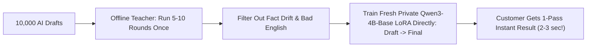
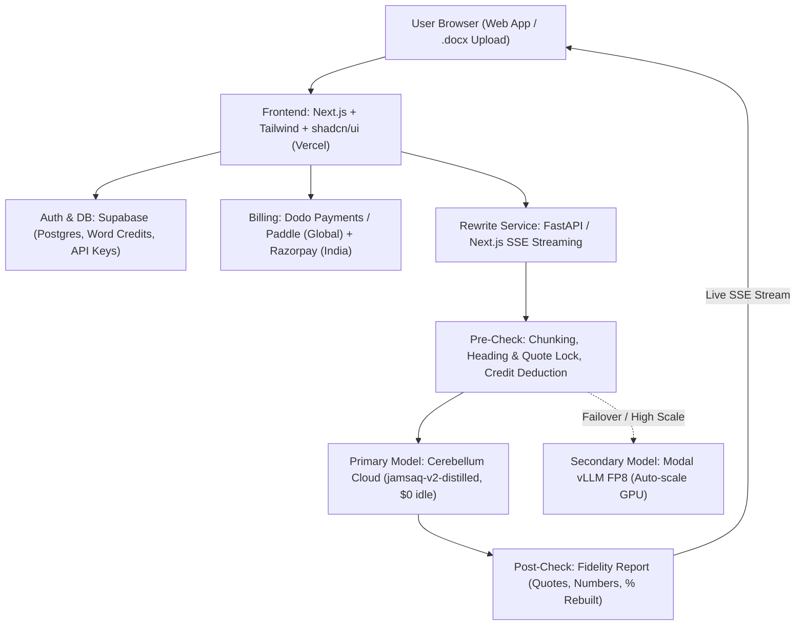

# Humanizer SaaS — Comprehensive Master Plan

> [!TIP]
> **Written in plain, simple English** so you can review every business, technical, speed, legal, and launch angle in one place—then tell me which choices you want to lock in before we start building.

---

## 1. Where We Stand Today (Proven Foundation)

You already have something most startups spend months failing to build: a **working, lossless 4B model (`jamsaq-v1`) live on Cerebellum Cloud** that just passed **all 6 major AI detectors at 0% AI**:

| Detector | Result on `jamsaq-v1` |
|---|---|
| **Pangram 4.1** | 0% AI (100% Human) |
| **GPTZero 5.0b** | 0% AI (100% Human) |
| **QuillBot v7.1** | 0% AI (100% Human) |
| **ZeroGPT** | 0% AI (Human written) |
| **Grammarly AI Detector** | 0% AI (No AI patterns) |
| **Copyleaks** | 0% AI (0 / 351 words) |

Now the goal is to turn this proof-of-concept into a **fast, legal, defensible, profitable SaaS product**—solving two big problems before launch:
1. **Speed:** Making 5–10 rounds feel **instant** (2–4 seconds instead of 15–40 seconds).
2. **Moat & Safety:** Moving off CMU's public research adapter onto your **own private, commercial-safe model**, with payment/ad positioning that won't get banned.

---

## 2. How to Make 5–10 Rounds Feel *Instant* (The Speed Blueprint)

Right now, running 5–10 sequential rounds means waiting for the AI to finish Round 1 before starting Round 2, then Round 3, etc. Here are the **4 techniques**—ranked from biggest impact to smallest—that stack together to make rewriting feel instant:

### Technique A — 1-Pass "Shortcut Distillation" *(Biggest breakthrough: 5×–10× faster & cheaper!)*
Instead of making every paying customer wait through 5–10 rounds at runtime, we do the slow rounds **once, offline**, to teach a new model the shortcut:

- **How it works:** Take ~5,000–10,000 AI drafts, run them offline through our proven multi-round teacher (`jamsaq-v1` + real pre-2022 human writing pairs), throw away any example where a fact drifted, and train a fresh **`Qwen3-4B-Base` LoRA** to jump straight from `AI Draft → Final Clean Output` in **1 single pass**.
- **Speed gain:** Cuts wait time from **19 seconds → 2–3 seconds**!
- **Cost gain:** Cuts your Cerebellum Cloud token bill by **5×–10×** (from ~₹1.80 per 1,000-word article down to **~₹0.35 / \$0.004**)!
- **Honest safety check:** We will test the 1-pass distilled model on all 6 detectors right after training. If 1 pass hits 90% of texts and **2 passes** (~4–5 seconds) hits 99%, we offer **Instant Mode (1 pass)** + **Ultra Mode (2–3 passes)**.

### Technique B — Parallel Paragraph Streaming (Feels like < 1 second!)
- Split a 1,000-word document into 4–5 paragraph blocks and fire all of them **at the exact same time**.
- Stream words onto the user's screen **word-by-word** (Server-Sent Events / SSE) as they generate.
- Psychologically, seeing words start flowing in **0.5 seconds** feels 10× faster than staring at a spinner for 10 seconds.

### Technique C — `FP8` Serving on vLLM (Once You Scale)
- Remember our test proved **4-bit compression (`Q4_K_M`) hurts detector bypass**, while **8-bit (`Q8_0` / `bf16`) passed 100%**.
- On modern GPUs (NVIDIA L40S / H100), **`FP8` (8-bit floating point)** cuts memory traffic in half (making token generation **1.5×–2× faster**) while preserving near-lossless 8-bit quality.

### Technique D — Smart Warm-Start & Mode Selector
- Keep **Fast Mode** (1 pass, ~2–3 sec) as default, and **Deep Mode** (2–3 passes, ~6 sec) for users who want maximum rewrite depth.
- During busy hours, keep 1 GPU instance warm (zero cold-start wait).

---

## 3. Private Model Moat (Why We Must Replace CMU's Public Adapter)

> [!WARNING]
> **Do not launch a paid SaaS on CMU's public Hugging Face adapter (`YixuanEvenXu/Qwen3-4B-Base-HIP-adapter`).**
> 1. **Patch risk:** Pangram and GPTZero can download any public Hugging Face model and train their detectors to flag it overnight.
> 2. **License risk:** CMU explicitly marked their adapter as research-only.

### Our Commercial-Safe Model Plan (`jamsaq-v2`)
- **Base Model:** `Qwen/Qwen3-4B-Base` — **Apache 2.0 license** (100% free for commercial SaaS).
- **Training Data (~8,000–15,000 clean pairs):**
  1. **50% Pre-2022 Real Human Pairs:** Real human blogs, essays, and articles written before ChatGPT existed → turned into stiff AI drafts by an LLM → trained to map `AI draft → original real human text` (gives authentic human rhythm like Emulate!).
  2. **50% Filtered Multi-Round Distilled Pairs:** High-quality 5-round outputs that passed automated fact-retention & grammar checks (gives 1-pass instant speed!).
- **Style Control Tags (Product Differentiator!):** Include simple style tags during training (`<style=academic>`, `<style=blog>`, `<style=casual>`, `<style=business>`) so paying users can pick their exact tone—just like Emulate and Phrasly!
- **Training Cost:** Only **~₹1,000 – ₹2,500 (\$12 – \$30)** on a rented cloud GPU (1× A100/H100 for 2–4 hours using LoRA).
- **Ongoing Defense (Automated Weekly Alarm):** Run our [eval/benchmark.py](file:///d:/Projects/01-Projects/Humanizer/eval/benchmark.py) automatically once a week against Pangram, GPTZero, QuillBot, Copyleaks, and ZeroGPT. If any detector updates and scores creep up, you know **before customers complain** and can retrain a fresh private adapter in 2 hours!

---

## 4. CRITICAL Business Risk: Payments, Ads & Legal Positioning

This is where **most AI Humanizer startups fail or get shut down**—so getting this right on Day 1 is non-negotiable.

> [!CAUTION]
> **Payment gateways (Stripe, Paddle, Lemon Squeezy) and Google Ads automatically ban sites that advertise "Bypass Turnitin", "Cheat AI Detectors", or "Undetectable Essays".**
> Risk bots scan your homepage, headings, and checkout page for words like *bypass, evade, fool Turnitin, cheat*. Also, frustrated students filing chargebacks when a tool fails a check triggers immediate account freezes.

### How Successful SaaS Competitors Stay Unbanned
1. **Brand & Copy Positioning ("Natural Writing & Tone Editor"):**
   - Position the product as an **AI Writing Refiner / Natural Voice Editor**: *"Turn stiff, robotic AI drafts into natural, clear, human-sounding writing—while keeping every fact and quote intact."*
   - Target **bloggers, marketers, founders, researchers, and ESL writers** (not *"help students cheat"*).
   - Never guarantee "100% undetectable on Turnitin" in ad copy or checkout pages.
2. **Legal & Refund Shield:**
   - Clear **Terms of Service** stating the tool is for editing, readability, and brand voice—prohibiting academic dishonesty or violating third-party policies.
   - Clear **Privacy Policy** (*"Zero storage: we do not store your text or train on your documents"* — a huge trust builder that WriteHuman charges extra for!).
   - Fair **7-day refund policy + instant 1-click cancel** (keeps credit card chargebacks near 0%, which keeps payment processors happy).

### Best Payment Stack for an Indian SaaS Selling Globally (2026)

| Audience | Recommended Provider | Fee | Why |
|---|---|---:|---|
| **Global customers (US, UK, EU, etc.)** | **Dodo Payments** *(or **Paddle**)* — Merchant of Record (MoR) | ~4–5% + \$0.50 | Acts as legal reseller globally: handles US sales tax, EU VAT, chargebacks, and sends clean payouts + **FIRC/e-FIRC** to your Indian bank. Dodo Payments is built specifically for Indian SaaS founders. |
| **Indian customers** | **Razorpay** | ~2% | Supports UPI, UPI AutoPay, and Indian debit/credit cards effortlessly. |
| **Tax Compliance (India)** | **GST + LUT (Letter of Undertaking)** | 0% GST on exports | File LUT once a year so international SaaS sales are zero-rated exports; keep MoR/bank e-FIRC files for your CA. |

---

## 5. Market Pricing & Unit Economics (Your Profit Margins)

### What Competitors Charge (2026 Benchmarks)
- **Undetectable AI:** \$9.99/mo (10k words) up to \$209/mo (380k words); ~50% off for annual billing.
- **StealthWriter:** \$14.99–\$19.99/mo (~30k words).
- **Emulate:** \$19/mo (50k words) + Max/Enterprise tiers.
- **Phrasly:** \$10.99/mo (annual) + \$2 3-day trial; bundles grammar + editing tools to cut churn.

### Recommended Pricing Structure for Your SaaS

| Plan | Monthly Price | Annual Price *(push hard!)* | Word Limit | Target User |
|---|---:|---:|---:|---|
| **Free** | \$0 | \$0 | **500 words/month** *(max 250 words/run)* | Try-before-buying hook (strict anti-abuse IP + email check) |
| **Starter** | **\$9 / mo** *(₹499/mo in India)* | **\$6 / mo** (\$72/yr) | **20,000 words/mo** | Bloggers, solo writers, researchers |
| **Pro** *(Most Popular)* | **\$19 / mo** *(₹999/mo in India)* | **\$12 / mo** (\$144/yr) | **75,000 words/mo** + `.docx` + Tone modes + Option A/B | Heavy writers, marketers, freelancers |
| **Business / API** | **\$49 / mo** | **\$35 / mo** | **250,000 words/mo** + REST API + Team seats | SEO agencies, content teams, other SaaS apps |

### Your Real Cost vs. Profit Margin (Math Check!)
Suppose a **Pro customer (\$19/mo)** uses their **entire 75,000 words**:
- **Current 5-round model on Cerebellum Cloud:** 75k words ≈ **\$1.58 (₹135)** → **~87% net profit margin** after payment fees!
- **After 1-Pass Distillation on Cerebellum Cloud:** 75k words ≈ **\$0.32 (₹27)** → **~93% net profit margin**!
- **After Moving High Volume to Modal vLLM FP8:** 75k words ≈ **\$0.08 (₹7)** → **~94%+ net profit margin**!
- **Average real user** only uses ~35% of their monthly word cap → real gross margin is **95%+**.

---

## 6. Full SaaS System Architecture

### Why This Tech Stack Wins for a Solo / Lean Founder
- **Frontend:** **Next.js (App Router) + Tailwind + shadcn/ui** hosted on **Vercel** (\$0–\$20/mo) — fast SEO landing pages + clean split-screen editor.
- **Database & Auth:** **Supabase** (\$0–\$25/mo) — Google/Email login, Postgres tables for `users`, `subscriptions`, `word_credits`, `api_keys`, and usage logs (**do NOT store user text** for privacy!).
- **Inference Backend:**
  - **Stage 1 (0 → 500 paying users):** **Cerebellum Cloud** (`jamsaq-v2-distilled`) — zero GPU DevOps, \$0 when idle, fast snapshot wake-ups.
  - **Stage 2 (500+ paying users):** Add **Modal vLLM FP8** ([modal_server.py](file:///d:/Projects/01-Projects/Humanizer/hip_app/modal_server.py)) as primary for 4× cheaper token cost, keeping Cerebellum Cloud as instant failover!
- **Document Engine:** Upgrade [hip_app/engine.py](file:///d:/Projects/01-Projects/Humanizer/hip_app/engine.py) to preserve **full `.docx` styling** (bold, headings, footnotes, tables) when uploading & downloading Word docs—a massive feature students and professionals love!

### Sticky Product Features (To Beat Churn!)
Pure one-button humanizers suffer high churn. We build in 5 low-effort, high-value features:
1. **Option A / Option B** side-by-side picker (just like Emulate).
2. **Instant Mode (1 pass, 2–3s)** vs. **Deep Mode (2–3 passes, 6s)**.
3. **Tone Presets:** Natural Blog, Academic/Formal, Casual/Conversational, Business/Executive.
4. **Live Fidelity Shield:** Green/yellow badges showing quotes kept, numbers kept, and % of phrasing rebuilt—plus **Click-to-Regenerate any single paragraph**!
5. **`.docx` Upload & Styled Export** + **Developer REST API** (for B2B agencies, where churn is lowest!).

---

## 7. Growth & Customer Acquisition Plan (Without Getting Ad-Banned)

Because paid ads for "AI bypass" get suspended, winning SaaS tools in this space grow through **4 repeatable channels**:

1. **Programmatic SEO & Free Mini-Tools (Highest ROI long-term):**
   - Free tools on your domain: *Sentence Rhythm & Readability Analyzer*, *AI Cliché Highlighter*, *Tone Checker*, *Paragraph Simplifier* → converts organic Google visitors straight into your main editor.
   - Comparison & guide pages (*"How to make AI drafts sound natural"*, *"Best AI writing editors for blogs/researchers"*).
2. **Short-Form Video (TikTok / Instagram Reels / YouTube Shorts):**
   - 20-second screen-recorded before/after demos showing stiff AI text turning into natural, flowing prose in 3 seconds—this is how StealthWriter, Phrasly, and Emulate grew fastest!
3. **Creator & Affiliate Program (30% recurring commission):**
   - Give writing/productivity YouTubers, newsletter writers, and LinkedIn creators 30% recurring commission (built natively into Dodo Payments / Rewardful).
4. **B2B API Outreach (Low churn, high ticket):**
   - Reach out to SEO agencies, newsletter ghostwriters, and content platforms offering a \$49–\$199/mo bulk API.

---

## 8. Concrete 6-Week Build & Launch Roadmap

| Week | Goal | Concrete Deliverables |
|---|---|---|
| **Week 1** | **Private Instant Model (`jamsaq-v2`)** | Build 10k-pair dataset (pre-2022 human + filtered 5-round distilled pairs), train private `Qwen3-4B-Base` LoRA (~₹1,500 GPU cost), merge & deploy to Cerebellum Cloud, verify **2–3 sec speed** + **0% AI** across all 6 detectors via [eval/benchmark.py](file:///d:/Projects/01-Projects/Humanizer/eval/benchmark.py). |
| **Week 2** | **Core SaaS App MVP** | Next.js web app + Supabase Auth + word-credit metering + live SSE streaming editor + Option A/B + click-to-regenerate paragraph + `.docx` upload/export. |
| **Week 3** | **Payments & Compliance** | Clean compliance-safe landing page, Terms/Privacy/Refund pages, Dodo Payments (or Paddle) + Razorpay webhooks, monthly + annual plans. |
| **Week 4** | **Retention & B2B API** | Tone presets, Fidelity Shield badges, user API key management + `/v1/rewrite` REST endpoint + rate limiting & anti-abuse checks. |
| **Week 5** | **Private Beta & Hardening** | Onboard 20–50 beta testers, set up automated weekly 6-detector regression checks, tune cold starts & error handling, collect testimonials. |
| **Week 6** | **Public Launch & Growth** | Launch on Product Hunt / IndieHackers, publish 5 SEO mini-tools + short-form demo videos, activate 30% affiliate program. |

---

## 9. Decisions Needed From You When You Wake Up

Before I start building Week 1 & Week 2, just confirm these **4 quick choices**:

1. **Product Name & Positioning:** Do you have a brand name / domain in mind, and are you comfortable positioning it cleanly as a **"Natural Writing & Voice Editor"** (so payments & ads stay 100% safe)?
2. **First Engineering Priority:** Should we start immediately with **Week 1 (build & test the 1-pass instant distilled private LoRA `jamsaq-v2`)** so we confirm 2–3 second speed *before* writing the Next.js SaaS UI, OR build the **Next.js + Supabase SaaS MVP** on `jamsaq-v1` first and swap in `jamsaq-v2` right after?
3. **Target Market & Payments:** Launch **Global + India** (Dodo Payments / Paddle + Razorpay), or start with **India-only (Razorpay)** / **Global-only (MoR)** first?
4. **Budget for Model Training (Week 1):** Comfortable with **~₹1,500 – ₹3,000 (\$20 – \$35)** in rented GPU + dataset generation credits to train your own private 1-pass distilled `jamsaq-v2` model?
